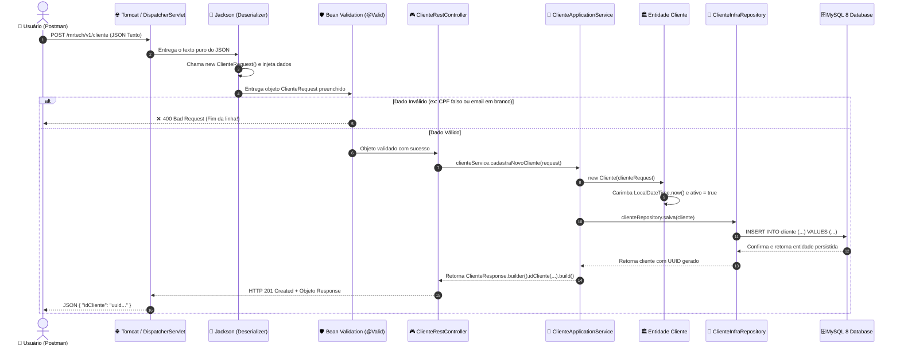

# 📘 Guia Definitivo de Arquitetura: Projeto Cliente API (Do Zero à Produção)

> **Autor:** Bruno Bernardo Soares Martins  
> **Comunidade / Squad:** MRTech (Mentoria Tech Lead Oscar Ribeiro)  
> **Ecossistema:** Java 17 • Spring Boot 3 • Spring Data JPA • Hibernate ORM • MySQL 8 • Lombok • Jakarta Bean Validation  
> **Padrão Arquitetural:** Arquitetura Hexagonal (Ports & Adapters) / Clean Architecture / Domain-Driven Design (DDD)  
> **Repositório:** `brubms/cliente-repeticao1`

---

## 🗺️ Visão Geral: O Ciclo de Criação Inside-Out (De Dentro para Fora)

Na engenharia de software profissional, não começamos uma API pela rota HTTP nem pelo banco de dados. Construímos a aplicação a partir do núcleo de negócio em direção às bordas externas:

```text
[Passo 0: Pacotes]           A Estrutura de Pastas e a Regra de Dependência
       ↓
[Passo 1: Domínio]           A Entidade Cliente.java e o Enum Sexo.java (O Coração)
       ↓
[Passo 2: Fronteira DTO]     ClienteRequest e ClienteResponse (A Blindagem de Entrada/Saída)
       ↓
[Passo 3: Persistência]      ClienteRepository e ClienteInfraRepository (Portas & Adaptadores)
       ↓
[Passo 4: Casos de Uso]      ClienteService e ClienteApplicationService (O Maestro do Negócio)
       ↓
[Passo 5: Entrada HTTP]      ClienteAPI e ClienteRestController (A Portaria Web REST)
```

---

## 🏗️ Passo 0: A Arquitetura de Pacotes (A Planta Baixa)

Antes de criar qualquer classe, a estrutura de pastas deve ser estabelecida para garantir a **Regra de Dependência da Arquitetura Hexagonal**: *as camadas externas conhecem as internas, mas o núcleo nunca conhece as bordas.*

```text
br.com.bbsm.clienterepeticao1
│
├── 📁 domain
│     └── O Coração do Negócio: Entidades puras (Cliente.java) e Enums (Sexo.java).
│         Regra de Ouro: NUNCA importa classes de 'application.api', 'service' ou 'infra'.
│
├── 📁 application
│     ├── 📁 api
│     │     └── A Portaria Web: Controllers, Interfaces de contrato HTTP e DTOs (Request / Response).
│     │
│     ├── 📁 service
│     │     └── O Cérebro: Regras da aplicação e orquestração dos casos de uso (ClienteService / ApplicationService).
│     │
│     └── 📁 repository
│           └── As Portas de Saída: Interfaces contratuais para o banco de dados (ClienteRepository).
│
└── 📁 infra
      └── O Mundo Exterior (Adaptadores): Spring Data JPA (ClienteSpringDataJpaRepository) e ClienteInfraRepository.
```

---

## 🏛️ Passo 1: O Domínio e a Entidade (`domain.Cliente.java`)

A entidade é a primeira peça a nascer. Ela mapeia o modelo de dados relacional e encapsula o estado do cliente.

### 1. Cabeçalho e Anotações de Infraestrutura
```java
@Entity(name = "cliente")
@Data
@NoArgsConstructor
@AllArgsConstructor
public class Cliente {
```
* **`@Entity(name = "cliente")`**: Informa ao Hibernate/JPA que esta classe representa uma tabela física chamada `cliente` no MySQL.
* **`@NoArgsConstructor` (Obrigatório pelo JPA)**: 
  * Quando o Hibernate executa um `SELECT * FROM cliente`, ele utiliza **Reflexão do Java (Reflection)** para instanciar um objeto vazio na memória RAM (`new Cliente()`) e depois injeta os dados das colunas nas variáveis privadas. Sem esse construtor sem argumentos, buscas (`findById`, `findAll`) quebram com `InstantiationException`.
* **`@AllArgsConstructor`**: Cria o construtor com todos os parâmetros, essencial para testes unitários automatizados onde instanciamos objetos em memória sem passar pelo banco.
* **`@Data` (Lombok)**: Gera automaticamente em tempo de compilação: getters, setters, equals, hashCode e toString.

### 2. A Chave Primária e Identidade Universal (UUID)
```java
    @Id
    @GeneratedValue(strategy = GenerationType.AUTO)
    @Column(unique = true, nullable = false)
    private UUID idCliente;
```
* **`@Id`**: Define o identificador único (Primary Key - PK) da tabela.
* **`@GeneratedValue(strategy = GenerationType.AUTO)`**: Delega a geração automática do valor do ID para o provedor de persistência.
* **`@Column(unique = true, nullable = false)`**: Garante restrição no MySQL de unicidade e não-nulidade.
* **Por que `UUID` em vez de `Long` sequencial?**
  * **Segurança contra Ataques de Enumeração (IDOR):** Um ID numérico sequencial (`1, 2, 3...`) permite que qualquer usuário tente acessar registros de terceiros apenas mudando a URL (`/cliente/16` ➔ `/cliente/17`).
  * O UUID (128 bits pseudo-aleatórios) é impossível de adivinhar e facilita sistemas distribuídos sem risco de colisão.

### 3. Atributos de Negócio & Bean Validation
```java
    @NonNull
    @NotBlank
    @Size(min = 10)
    private String nomeCompleto;

    @CPF
    private String cpf;

    @NotNull
    @NotBlank
    private String email;

    @Size(min = 10, max = 13)
    private String telefone;

    @NotNull
    @Enumerated(EnumType.STRING)
    private Sexo sexo;

    @NotNull
    @Size(min = 10, max = 13)
    private String celular;

    @NotNull
    private LocalDate dataNascimento;
```
* **`@NotNull`**: Garante que a referência não seja `null`.
* **`@NotBlank`**: Usado em `String`. Garante que não é `null`, não é vazio (`""`) e não contém apenas espaços em branco (`"   "`).
* **`@Size(min, max)`**: Limita o comprimento de caracteres, protegendo contra números incompletos ou estouro de buffer.
* **`@CPF`**: Validação algorítmica real do dígito verificador do CPF (módulo 11 pelo Hibernate Validator).
* **`@Enumerated(EnumType.STRING)`**: 
  * Salva o texto literal (`"MASCULINO"`, `"FEMININO"`, `"OUTROS"`) no MySQL.
  * **Perigo evitado:** Sem o `STRING`, o JPA salva como números ordinais (`0, 1`). Se a ordem do enum for alterada no Java, o banco de dados inteiro fica corrompido!

### 4. Atributos de Auditoria e Sistema (Não enviados pelo usuário)
```java
    private LocalDateTime dataHoraCadastro;
    private LocalDateTime dataHoraAtualizacao;
    private boolean ativo = true;
```
* O usuário no JSON do Postman não envia esses dados.
* `ativo = true`: Todo cliente cadastrado nasce ativo por padrão do negócio.
* `dataHoraCadastro`: Registrada no servidor no momento exato da criação.

### 5. O Construtor Rico (Proteção de Integridade)
```java
    public Cliente(ClienteRequest clienteRequest) {
        this.nomeCompleto = clienteRequest.getNomeCompleto();
        this.cpf = clienteRequest.getCpf();
        this.email = clienteRequest.getEmail();
        this.telefone = clienteRequest.getTelefone();
        this.sexo = clienteRequest.getSexo();
        this.celular = clienteRequest.getCelular();
        this.dataNascimento = clienteRequest.getDataNascimento();
        this.dataHoraCadastro = LocalDateTime.now();
    }
```
* **Princípio:** A própria Entidade sabe como nascer a partir de um `ClienteRequest` validado.
* **Evita Código Anêmico:** Não expõe o cliente a nascer incompleto através de múltiplos `setters` desgovernados no Service.
* **Carimbo do Servidor:** `LocalDateTime.now()` é definido diretamente na criação.

---

## 🛡️ Passo 2: A Fronteira da API — Os DTOs (`application.api`)

DTO significa **Data Transfer Object** (Objeto de Transferência de Dados). Ele funciona como o envelope que transporta dados entre a web e o backend.

### 1. `ClienteRequest.java` (DTO de Entrada)
```java
@Getter
@Builder
@AllArgsConstructor
@NoArgsConstructor
public class ClienteRequest {
    private String nomeCompleto;
    @CPF
    private String cpf;
    @NotBlank
    private String email;
    @Size(min = 10, max = 13)
    private String telefone;
    @NotNull
    private LocalDate dataNascimento;
    private Sexo sexo;
    private String celular;
}
```
* **Por que tem `@Getter` e NÃO tem `@Setter`?**  
  Imutabilidade! Uma vez lido da rede, ninguém no sistema deve adulterar os dados enviados pelo usuário.
* **O papel do `@NoArgsConstructor` aqui:**  
  Não é para o Hibernate! Aqui ele serve para a biblioteca **Jackson** (do Spring Web) instanciar o objeto vazio na memória RAM e preenchê-lo a partir do texto do JSON.
* **Campos Omitidos e o Ataque de Over-Posting (Mass Assignment):**  
  O `ClienteRequest` NÃO contém `idCliente`, `dataHoraCadastro` nem `ativo`. Isso impede que usuários mal-intencionados forjem IDs ou alterem o estado interno do sistema pelo payload.

### 2. `ClienteResponse.java` (DTO de Saída)
```java
@Getter // ou @Value
@Builder
public class ClienteResponse {
    private UUID idCliente;
}
```
* **Por que retornar apenas o `idCliente` no `POST`?**  
  Pelo padrão RESTful: quem cadastrou já sabe os dados que enviou. O retorno deve entregar o **identificador único oficial (UUID)** gerado pelo banco para aquele novo recurso, com código HTTP `201 Created`.
* **`@Value` vs `@Getter` (O Padrão do Tech Lead Oscar):**  
  O `@Value` do Lombok já inclui o `@Getter`, torna todos os atributos `private final` e torna a classe `final`, garantindo um **Value Object 100% imutável**.

---

## 🔌 Passo 3: A Persistência & A Inversão de Dependência (Ports & Adapters)

Para não amarrar as regras de negócio a um banco de dados específico, aplicamos o **Princípio da Inversão de Dependência (D do SOLID)** dividindo a persistência em **3 peças**:

```text
application.service
       ↓ (chama a tomada)
application.repository.ClienteRepository (A Porta / Interface Pura)
       ↑ (implementa o plugue)
infra.ClienteInfraRepository (O Adaptador Concreto @Repository)
       ↓ (usa a ferramenta)
infra.ClienteSpringDataJpaRepository (Spring Data JpaRepository)
       ↓
MySQL 8 Database
```

### 1. A Porta: `ClienteRepository.java` (Interface em `application.repository`)
```java
public interface ClienteRepository {
    Cliente salva(Cliente cliente);
    Cliente buscaPorId(UUID idCliente);
    List<Cliente> buscaTodosClientes();
    void deletaPorId(UUID idCliente);
}
```
* **Contrato puro:** Não tem anotações do Spring, não estende nada de framework. Define apenas **O QUE** o domínio precisa do banco.

### 2. A Ferramenta: `ClienteSpringDataJpaRepository.java` (Interface em `infra`)
```java
public interface ClienteSpringDataJpaRepository extends JpaRepository<Cliente, UUID> {
}
```
* Herda os métodos do Spring Data JPA (`save`, `findById`, etc.). O Spring cria a implementação em tempo de execução via *Dynamic Proxies*.

### 3. O Adaptador Concreto: `ClienteInfraRepository.java` (Classe em `infra`)
```java
@Repository
@RequiredArgsConstructor
@Log4j2
public class ClienteInfraRepository implements ClienteRepository {

    private final ClienteSpringDataJpaRepository jpaRepository;

    @Override
    public Cliente salva(Cliente cliente){
        log.info("[inicia] ClienteInfraRepository - salva");
        Cliente salvaCliente = jpaRepository.save(cliente);
        log.info("[finaliza] ClienteInfraRepository - salva");
        return salvaCliente;
    }
}
```
* **`@Repository`:** Registra o bean no Spring e traduz exceções do MySQL em `DataAccessException`.
* **`private final ... jpaRepository` + `@RequiredArgsConstructor`:** Injeção de Dependência recomendada pelo Spring (via construtor), garantindo imutabilidade e eliminando o `@Autowired` em campos.
* **`salva(Cliente cliente)`:** Executa `jpaRepository.save(cliente)`, onde o Hibernate gera o UUID, executa o `INSERT INTO cliente`, grava no MySQL e retorna a entidade com o ID preenchido.

---

## 🧠 Passo 4: O Maestro da Aplicação — A Camada de Serviço (`application.service`)

O Service é o **orquestrador dos Casos de Uso**. Ele não desenha telas nem executa SQL; ele comanda o fluxo entre DTOs, Entidades e Repositórios.

### 1. A Interface de Contrato: `ClienteService.java`
```java
public interface ClienteService {
    ClienteResponse cadastraNovoCliente(ClienteRequest clienteRequest);
    ClienteDetalhadoResponse buscaClientePorId(UUID idCliente);
    List<ClienteListResponse> listaTodosClientes();
    void deletaClientePorId(UUID idCliente);
}
```
* Estabelece os limites da aplicação. Recebe e retorna DTOs, mantendo a entidade protegida.

### 2. A Implementação: `ClienteApplicationService.java`
```java
@Service
@RequiredArgsConstructor
@Log4j2
public class ClienteApplicationService implements ClienteService {

    private final ClienteRepository clienteRepository;

    @Override
    public ClienteResponse cadastraNovoCliente(ClienteRequest clienteRequest) {
        log.info("[inicia] ClienteApplicationService - cadastraNovoCliente");
        Cliente cliente = clienteRepository.salva(new Cliente(clienteRequest));
        log.info("[finaliza] ClienteApplicationService - cadastraNovoCliente");
        return ClienteResponse.builder().idCliente(cliente.getIdCliente()).build();
    }
}
```
* **`private final ClienteRepository clienteRepository;`**: Repare que o Service injeta a **Interface** de `application.repository`, e **NÃO** a classe de `infra`. Desacoplamento absoluto!
* **A Linha Mágica:** `clienteRepository.salva(new Cliente(clienteRequest))` transforma o DTO em Entidade rica, executa a persistência e recupera o ID gerado para montar o `ClienteResponse`.

---

## 🚪 Passo 5: A Portaria Web — A Camada de Entrada HTTP (`application.api`)

A camada web é a porta de entrada que atende a internet e entrega os dados para a aplicação.

### 1. O Contrato HTTP: `ClienteAPI.java` (Interface)
```java
@RequestMapping("/cliente")
public interface ClienteAPI {

    @PostMapping
    @ResponseStatus(HttpStatus.CREATED)
    ClienteResponse postCadastraNovoCliente(@RequestBody @Valid ClienteRequest clienteRequest);

    @GetMapping
    @ResponseStatus(HttpStatus.OK)
    List<ClienteListResponse> getListaTodosClientes();

    @GetMapping("/{idCliente}")
    @ResponseStatus(HttpStatus.OK)
    ClienteDetalhadoResponse getBuscaClientePorId(@PathVariable UUID idCliente);

    @DeleteMapping("/{idCliente}")
    @ResponseStatus(HttpStatus.NO_CONTENT)
    void deletaClientePorId(@PathVariable UUID idCliente);
}
```
* **Separar Contrato de Implementação:** A interface centraliza mapeamento de rotas (`@RequestMapping`), status HTTP (`@ResponseStatus`), filtros de validação (`@Valid`) e corpo da requisição (`@RequestBody`).

### 2. O Controlador Concreto: `ClienteRestController.java`
```java
@RestController
@RequiredArgsConstructor
@Log4j2
public class ClienteRestController implements ClienteAPI {

    private final ClienteService clienteService;

    @Override
    public ClienteResponse postCadastraNovoCliente(ClienteRequest clienteRequest){
        log.info("[inicia] ClienteRestController - postCadastraNovoCliente");
        ClienteResponse cliente = clienteService.cadastraNovoCliente(clienteRequest);
        log.info("[finaliza] ClienteRestController - postCadastraNovoCliente");
        return cliente;
    }
}
```

### 💡 O Segredo do `@RestController`:
$$\mathbf{@RestController = @Controller + @ResponseBody}$$

* No `@Controller` tradicional do Spring MVC, o método procurava uma página HTML (`"cliente.html"`).
* No **`@RestController`**, o `@ResponseBody` embutido avisa ao Spring:  
  *"Não procure telas HTML! Pegue o objeto retornado, passe para o **Jackson**, converta para texto estruturado **JSON** e escreva diretamente no corpo da resposta HTTP (`Response Body`)!"*

---

## 🔄 A Jornada Completa do Dado em 8 Estações



---

## 🏁 Conclusão e Próximos Passos (Roadmap de Evolução)

Com essa fundação 100% dominada, o ciclo de vida dos endpoints da API de Cliente segue a esteira padronizada:

* [x] **Cadastro de Cliente:** `POST /cliente` (Retorna `201 Created` com `ClienteResponse`)
* [x] **Busca Detalhada:** `GET /cliente/{idCliente}` (Retorna `200 OK` com `ClienteDetalhadoResponse`)
* [x] **Listagem Geral:** `GET /cliente` (Retorna `200 OK` com `List<ClienteListResponse>` via Java Streams)
* [x] **Exclusão com Integridade:** `DELETE /cliente/{idCliente}` (Retorna `204 No Content` aplicando Fail-Fast)
* [ ] **Alteração de Dados (Issue #72):** `PATCH /cliente/{idCliente}` (Atualização parcial com método de negócio rico na Entidade e Dirty Checking do Hibernate)
